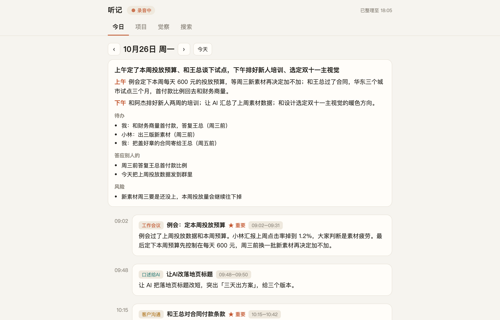
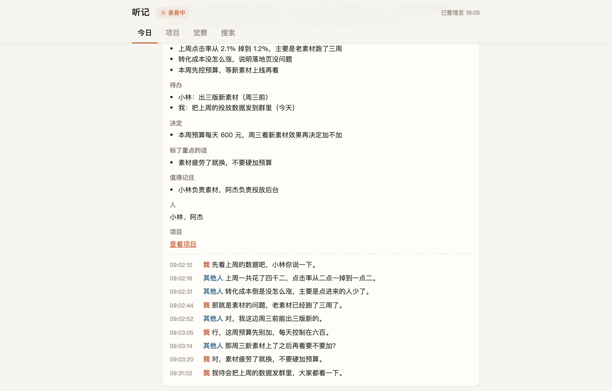
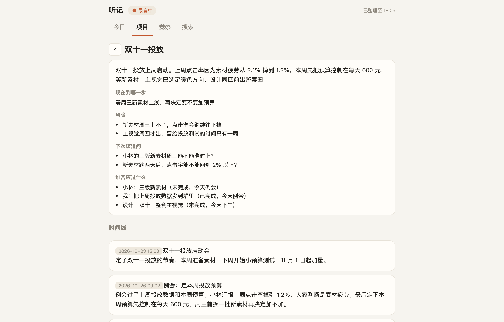
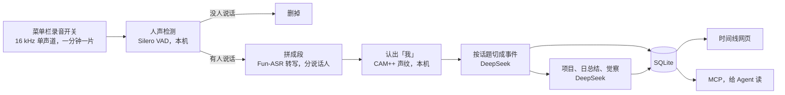

# 听记

在 Mac 上全天听你说话的小工具。没人说话的时候什么都不留；有人说话就转成逐句原文，按事情整理成摘要、待办和项目。Claude Code 这类 Agent 可以通过 MCP 直接读这些记录。

思路来自 OPPO 的「心力球」：挂在身上全天录音，自动按事情整理。听记把这套做法搬到了电脑上：不用另买设备，数据都在自己电脑上，原话全部保留，还能接给自己的 Agent。



## 它会做什么

- **全天听，没人说话不留**：麦克风每分钟交一片，本机做人声检测（Silero VAD），没人说话的分片直接删掉。
- **逐句原文**：有人声的部分送去转写（阿里云百炼 Fun-ASR），同时分说话人；本机声纹模型（3D-Speaker CAM++）认出哪句是你说的，标成「我」，其余的标「其他人」。
- **按事情切**：两段话隔开 5 分钟以上一定分开，同一段里再按话题切成一件件事。每件事有分类、标题、摘要、要点、待办、决定、值得记住的事和重要度，零碎小事只留一行。
- **项目**：同一件事聊了好几天，会自动串成一条线，写明现在到哪一步、有什么风险、下次该追问什么、谁答应过什么。
- **每日总结**：每天 23:30 以后，按上午、下午、晚上写一份当天的总结。
- **觉察**：每周日晚上，只看「我」说过的话，找出两三个沟通和做事上的习惯，每条带原话依据和下次可以怎么做。
- **电脑放声音时自动暂停**：每秒看一次哪个程序在出声。抖音、浏览器、播放器在放视频，就先停麦克风，声音停 2 秒后接着录。微信、企业微信、飞书、腾讯会议、钉钉、Zoom、FaceTime 通话，以及闪电说、Typeless 这类语音输入出声，不会暂停。
- **时间线网页**：浏览器打开 http://127.0.0.1:7788/ ，有今日、项目、觉察、搜索四页。点开一件事能看逐句原文，点某一句就从那里开始播放录音。网页只对本机开放。
- **导入 iPhone 语音备忘录**：手机上录的备忘录通过 iCloud 同步到 Mac 后，一条命令导进来，和电脑上录的放在一起整理。

<table>
<tr>
<td width="50%"></td>
<td width="50%"></td>
</tr>
<tr>
<td align="center">一件事：要点、待办、决定，下面是逐句原文</td>
<td align="center">项目：跨天串起来，记着谁答应过什么</td>
</tr>
</table>

截图里的人和事都是编的示例，见下面的「先看效果」。

## 给 Agent 用：MCP

装好以后注册一个 MCP（见「安装」第 3 步），Agent 就能回答这类问题：

- 「我昨天答应了谁什么？」
- 「把上周聊定价的原话找出来。」
- 「双十一投放那件事现在到哪一步了？下次见面该问什么？」

| 工具 | 做什么 |
|---|---|
| `list_records` | 一段时间里的全时记（自动切出来的事，E 开头）和随口记（N 开头） |
| `get_record` | 按编号取一件事的全部字段，可带逐句原文；P 开头是项目 |
| `get_transcript` | 逐句原文，带时间和说话人，不管有没有整理成事件 |
| `search` | 在原话、事件摘要、随口记里搜关键词 |
| `todos` | 最近几天冒出来的待办和承诺 |
| `list_projects` / `get_project` | 项目列表；一个项目的现状、风险、该追问的问题、承诺和时间线 |
| `day_summary` | 某一天的总结 |
| `insights` | 每周的觉察 |
| `memories` | 从各件事里抽出来值得长期记住的事实，带出处 |
| `recorder_status` | 现在在不在录、整理到几点了 |

还没处理完的时间段，结果里会写明「整理到几点」，Agent 不会把「还在转写」当成「没有记录」。

## 安装

需要：

- macOS 15 或更高
- 一个麦克风：MacBook、iMac 自带；Mac mini、Mac Studio 要接外置麦克风或耳机
- Homebrew 装的 ffmpeg、Python 3.11 或更高、Xcode 命令行工具（用来编译菜单栏的录音开关）
- 两个 API key：[阿里云百炼](https://bailian.console.aliyun.com/)（Fun-ASR 转写）和 [DeepSeek](https://platform.deepseek.com/)（整理）

```bash
brew install ffmpeg python@3.13
xcode-select --install        # 装过就跳过
git clone https://github.com/Biancuihuo/tingji.git
cd tingji
./install.sh
```

`install.sh` 会依次：建 Python 环境（仓库里的 `.venv`）、下载两个模型（约 28 MB）、问你两个 API key（存成权限 600 的 `secrets.json`）、编译并安装菜单栏录音开关、用 launchd 启动后台处理和时间线网页。三样都开机自启。

装完以后：

**1. 允许麦克风。** 菜单栏出现波形图标就是在录。第一次会弹出麦克风权限，点「允许」。

**2. 让它认出你。** 对着电脑一个人说 30 秒左右的话，等一两分钟，然后：

```bash
.venv/bin/tingji pieces                 # 找到刚才那段的编号
.venv/bin/tingji enroll --piece 编号     # 记下你的声纹
.venv/bin/tingji relabel                # 把已有的句子重新认一遍
```

不注册声纹也能用，只是所有话都会标成「其他人」，也做不了觉察。离电脑远时说的话如果认不出来，可以再加几个样本，最多留 12 个。

**3. 接到 Claude Code。**

```bash
claude mcp add tingji -s user -- "$PWD/.venv/bin/tingji-mcp"
```

新开一个会话就能用。其他支持 MCP 的客户端，命令填 `仓库路径/.venv/bin/tingji-mcp`。

## 先看效果

不录音、不填 key，也能先看看时间线是什么样：

```bash
./install.sh --python-only      # 问 key 时直接回车跳过
.venv/bin/python scripts/demo.py
```

然后在浏览器打开 http://127.0.0.1:7799/ 。示例数据放在仓库里的 `demo-home/`，不碰真正的数据目录。

## 日常用

**菜单栏**只有一个开关：开启或关闭录音、打开时间线、退出。图标是波形表示在录，喇叭表示电脑在放声音、暂停中，斜杠麦克风表示已关闭。

**命令行**（`.venv/bin/tingji`）：

| 命令 | 做什么 |
|---|---|
| `status` | 录音和后台在不在跑、整理到几点、今天记了什么 |
| `events --day 2026-10-26` | 某天的全部事件 |
| `pieces` | 最近录下的段，注册声纹时用来找编号 |
| `enroll --piece N` / `enroll --file 录音` | 给「我」加一个声纹样本 |
| `relabel` | 加了样本以后，把已有的句子重新认一遍 |
| `flush` | 不等 5 分钟，马上把已经转写的话整理成事件 |
| `redo --day D` | 删掉某天的事件重新整理（改了提示词以后用） |
| `import-memos --dry-run` | 看看有多少条 iPhone 语音备忘录可以导入；去掉 `--dry-run` 才真导 |
| `digest --day D` | 马上写某天的总结 |
| `insights` | 马上做一次觉察 |

**设置**：在 `~/Library/Application Support/Tingji/settings.json` 里写要改的项，后台每一轮都会重新读。

| 设置 | 默认 | 说明 |
|---|---|---|
| `owner` | `"用户"` | 你的名字，写进给模型的提示词 |
| `keep_audio_days` | `30` | 有人声的录音留多少天，`0` 表示一直留。文字永远保留 |
| `event_gap_s` | `300` | 两段话隔开多少秒以上算两件事 |
| `voice_match` | `0.6` | 声纹相似度到多少算「我」 |
| `llm_model` / `llm_fast_model` | `deepseek-v4-pro` / `deepseek-v4-flash` | 整理用的模型；一件事里说话不到 8 秒的用快的那个 |
| `mic_device_uid` | 空 | 指定用哪个麦克风，默认跟系统的默认输入走。设备 UID 用 `/Applications/听记.app/Contents/MacOS/Tingji --probe` 查 |
| `web_port` | `7788` | 时间线网页的端口 |

「今天」按北京时间算，要改时区就改 `tingji/config.py` 里的 `TZ`。

## 数据放在哪

全部在 `~/Library/Application Support/Tingji/`：

- `tingji.db`：SQLite，里面是逐句原文、事件、项目、总结、觉察和声纹
- `audio/`：有人声的录音，按天分目录，每小时人声约 14 MB
- `settings.json`、`secrets.json`（API key，权限 600）

日志在 `~/Library/Logs/Tingji*.log`。

会离开这台电脑的只有两样：有人声的录音片段，上传到阿里云百炼的临时存储做转写（百炼 48 小时后自动删除）；转写出来的文字，发给 DeepSeek 整理。人声检测和声纹都在本机算，时间线网页只对本机开放。

## 怎么做的



| 位置 | 是什么 |
|---|---|
| `app/` | 菜单栏录音开关（Swift）：录麦克风、电脑出声时暂停、每分钟交一片 |
| `tingji/worker.py`、`pipeline.py` | 后台，每 3 秒跑一轮：人声检测、拼段、转写、认声纹、切事件、归项目、总结、觉察 |
| `tingji/asr.py`、`llm.py`、`prompts.py` | Fun-ASR、DeepSeek 和给 DeepSeek 的提示词 |
| `tingji/audio.py`、`voice.py` | 解码和人声检测、声纹 |
| `tingji/web.py`、`web/index.html` | 时间线网页 |
| `tingji/mcp_server.py` | MCP；网页的接口直接复用这里的函数，网页和 Agent 看到的是同一份 |
| `tingji/cli.py` | 命令行 |

录音开关用 Swift 写，是因为 macOS 的麦克风权限是按 .app 给的，要一个签了名、写明用途的 .app 才能弹出授权。其余都是 Python。

## 费用

Fun-ASR 每小时 ¥0.79，只算有人声的部分。DeepSeek 每件事调一次，每个项目更新一次，每天一次总结，每周一次觉察。

我自己第一天从下午一点多开到半夜：录到 2 小时人声，1100 多句，4 万多字，转写花了不到 2 块钱。

## 还没做

- 通话对方的声音：现在只录麦克风，戴耳机打电话时只录得到自己这边。
- 多台电脑汇总到一台服务器，给团队一起用。
- 随口记和标重点：后台已经能处理，菜单栏还没加快捷键。想自己接的话，往数据目录的 `marks.jsonl` 里追加一行 `{"ts": 毫秒时间戳, "kind": "highlight"}`，或者一对 `note_start` / `note_end`。

## 卸载

```bash
./uninstall.sh
```

会停掉三个后台服务、删掉 `/Applications/听记.app`。录音和文字都还留在数据目录里，不要了再自己删。

## 致谢

- OPPO 心力球的产品思路
- [sherpa-onnx](https://github.com/k2-fsa/sherpa-onnx)、[Silero VAD](https://github.com/snakers4/silero-vad)、[3D-Speaker](https://github.com/modelscope/3D-Speaker)
- 阿里云百炼 Fun-ASR、DeepSeek

## License

MIT。作者边淬火，X：[@Biancuihuo](https://x.com/Biancuihuo)
